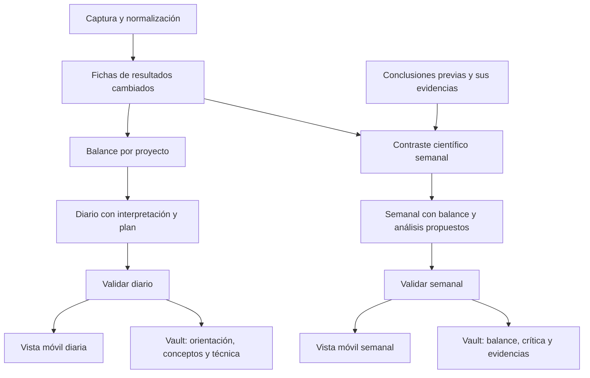

# Construcción jerárquica y reanudable del digest

Estado: rediseño aprobado de fase 2, implementado en IN-07/08/09/10/12 y en
validación real e independiente en IN-11. IN-07 bloquea la publicación incompleta;
IN-08 aporta observaciones y paquetes por fuente; IN-09 añade persistencia y
reanudación. El diario por niveles y la crítica semanal requieren todavía el
cotejo de muestras y la firma humana de IN-06. No se sustituye una sección
rechazada por contenido mecánico (D-047).

## Qué falla en el flujo actual

La validación real intentaba enriquecer 43 resultados en una cadena y solo después
construir síntesis y plan. Un resultado puede reunir numerosos diffs y documentos;
que el paquete esté por debajo del máximo no significa que sea una unidad fácil
de interpretar. La síntesis vuelve a recibir evidencias originales, extracciones
y contexto de todos los proyectos. El plan vuelve a recibir evidencias.

Los reintentos HTTP, la reparación y el proveedor de respaldo pueden consumir
mucho tiempo en una sola pieza. No se reserva un presupuesto para las etapas
superiores. Los resultados válidos se mantienen en memoria hasta terminar la
construcción: interrumpir obliga a repetirlos. La auditoría registra
`output_invalid`, pero pierde la regla y el campo concretos que causaron el rechazo.
Por eso todavía no sabemos cuánto corresponde a errores del modelo, contratos
mal dimensionados o falsos rechazos del validador.

Las pruebas sintéticas y la revisión independiente demostraron propiedades de
seguridad y trazabilidad, pero no bastaban para demostrar utilidad ni tiempos
adecuados con los proyectos reales. Cambiar el proveedor no resuelve por sí solo
estos problemas de construcción.

## Utilidad cotidiana y elección del próximo foco (D-049)

El resultado esperado es que la persona pueda seguir la evolución de un resultado,
explicar qué se sabe ahora y decidir dónde poner su atención después. Cada diario
debe relacionar novedades con el objetivo del proyecto, distinguir respaldo e
incertidumbre y ofrecer una misión ejecutable cuando proceda.

La misión propuesta explica por qué merece prioridad: valor científico, decisión
o trabajo que desbloquea, control o duda pendiente, dependencias, Kanvas y
compromisos humanos. Incluye acción y criterio de finalización; hasta dos
calentamientos son opcionales, sin rellenar el plan por obligación. Un plan aceptado
se mantiene como contexto si no hay motivo nuevo para cambiarlo. Las propuestas
no se aceptan automáticamente ni sobrescriben los ajustes de la persona.

La crítica semanal debe tener consecuencias para ese foco: mantener una línea,
restringir una interpretación, resolver un control antes de continuar o proponer
un contraste que diferencie explicaciones. Su utilidad se comprueba al revisar
resultados y elegir o ajustar prioridades, no contando documentos generados.

## Profundidad, frecuencia y canal: tres decisiones distintas

La jerarquía anterior era demasiado pesada si se interpretaba como una revisión
científica completa de todo el proyecto cada día. Se conserva como organización
interna, con trabajo incremental y piezas reutilizables. No implica una llamada
LLM por archivo ni obliga a la persona a leer todas las etapas.

La persona pide una profundidad intermedia para el diario y distintos niveles
según el canal. El diario también interpreta; el semanal añade un contraste
crítico explícito. El mensaje móvil y la vault son vistas del mismo contenido
validado, con distinta extensión, no informes independientes que puedan discrepar.

| Producto | Mensaje móvil (correo) | Informe en la vault |
| --- | --- | --- |
| Diario | Hasta tres novedades con su significado y la incertidumbre decisiva; misión y hasta dos calentamientos; tareas del intervalo en bloque compacto | Lectura inicial breve; explicación conceptual por proyecto de qué cambió, cómo se sabe y por qué importa; resultados, controles, límites, figuras y evidencias ampliables |
| Semanal | Cambios de conclusión o alertas más relevantes, decisiones propuestas y prioridad de la semana | Balance integrado y etapa crítica: conclusiones previas frente a evidencia nueva, matices/contradicciones, explicaciones alternativas y análisis discriminantes propuestos; inventario y detalle técnico consultables |

En la vault se distinguen tres niveles de lectura:

1. **Orientación:** qué cambió, qué significa y qué merece atención.
2. **Comprensión conceptual:** razonamiento por proyecto y resultado, controles,
   alcance e incertidumbre; profundidad suficiente para entender sin releer código.
3. **Comprobación técnica:** datos, parámetros, extractos, linaje y cobertura.

No se fuerza a recorrerlos de arriba abajo ni se desplazan limitaciones decisivas
al último nivel. Abreviar para el móvil no puede convertir una interpretación en
hecho ni eliminar una condición que cambie el significado. Se conserva la lista
de todas las tareas del intervalo; la lectura rápida corresponde a la entrada,
no a prometer que cualquier inventario enorme se lee completo en un minuto.

### Arranque y funcionamiento habitual

Los primeros días se construye una referencia inicial de conclusiones, resultados
y contexto. Ese trabajo puede ser mayor para el sistema, pero el inventario antiguo
no se presenta como producción de hoy ni obliga a revisar toda la historia. Debe
separarse el contexto histórico observado al dar de alta un proyecto de los
cambios con evidencia de evento en el intervalo. Los límites de esa referencia
inicial quedan visibles, sin inventar antigüedad ni comprensión humana.

Después se procesan los cambios y sus dependencias: resultado cambiado, balance
afectado y síntesis. No se rehacen fichas ni críticas históricas sin nueva entrada.
Una alerta científica importante aparece también en el diario; no espera al sábado.
La revisión extensa y la propuesta de contrastes se desarrollan en el semanal.

La primera implementación debe ser un recorrido vertical pequeño: un cambio real,
su explicación conceptual, sus dos vistas de canal y un contraste semanal. Se
amplía tras comprobar utilidad, latencia y aciertos/rechazos. No hace falta un
motor genérico de workflows ni una llamada de modelo por cada fragmento.

## Qué se considera terminado

Cada producto tiene su propio contrato de profundidad. El diario no depende de
terminar la crítica semanal ni de analizar toda la historia. Una carencia que
impida respaldar una afirmación necesaria del día sí deja pendiente esa pieza.

Un informe final contiene todas sus secciones requeridas, todos los resultados
del intervalo y un manifiesto que acredita qué validaciones pasó cada pieza.
Una sección fallida queda pendiente, con motivo y siguiente acción; no se convierte
en un apartado mecánico ni se disfraza como «no hay conclusión nueva».

La ausencia de actividad verificable, la falta de evidencia científica y un fallo
técnico son situaciones distintas. La primera puede producir una salida válida
si la captura la acredita. Una afirmación «no verificable» necesita una limitación
concreta y trazable. Un timeout o un JSON rechazado no justifican ninguna de ellas.

Los borradores pueden mostrar el inventario completo y qué falta, pero no se
entregan como digest final ni cierran el intervalo. La entrega final se desbloquea
solo cuando el manifiesto está completo. Esto no obliga a cerrar ninguna revisión
humana: «validado por el sistema» nunca significa «comprendido por la persona».

## Etapas y contratos

Cada flecha exige una entrada validada; los nodos independientes pueden seguir
avanzando aunque otro esté pendiente. El ensamblado final no salta una dependencia.

| Etapa | Entrada | Salida | Control principal |
| --- | --- | --- | --- |
| Captura | Fuentes declaradas y permitidas | Evidencias con hash, fecha y cobertura | Rutas, lectura estable, secretos, event/observed |
| Hechos por fuente | Fragmento coherente de una nota, ejecución, tabla o documento | Observaciones pequeñas y tipadas con referencias | Esquema por fuente; cifras y unidades contra el dato original |
| Resultado | Hechos relacionados con una tarea o experimento | Qué se hizo, qué respalda, controles, límites y preguntas | Todas las afirmaciones conservan evidencia; distinguir observación e interpretación |
| Proyecto | Fichas válidas, objetivo científico y contexto previo validado | Qué cambia respecto al objetivo, qué falta y qué decisión permite | No confundir actividad técnica con conclusión científica |
| Diario y plan | Balances válidos; tareas y dependencias de Kanvas; dudas humanas | Lo esencial y acciones ejecutables | Límites de secciones, dependencias, origen y trazabilidad |
| Crítica semanal | Conclusiones previas con su alcance y soporte; evidencias nuevas y controles | Qué se refuerza, matiza, cuestiona o queda sin resolver; propuesta de análisis discriminante | Comparabilidad, linaje de ambos lados, alternativas y límites; sin modificar estados humanos |
| Semanal | Fichas de siete días, crítica, revisiones y planes aceptados | Balance conceptual, decisiones, pendientes y objetivos | No resumir diarios ni usar una síntesis previa como única prueba |
| Ensamblado | Nodos válidos e inventario del intervalo | Informe completo y manifiesto | Ningún resultado oculto; ninguna sección requerida pendiente |

### Hechos antes de narrativa

El código sigue calculando métricas, identificando tareas, leyendo fechas y
vinculando figuras. El modelo no vuelve a calcular ni transcribe innecesariamente
esos valores. Se usa LLM para interpretar fragmentos que lo requieran, con un
contrato pequeño adecuado al tipo de fuente, sin pedir todas las listas de una
extracción general para cualquier entrada.

Los paquetes se dividen por significado y procedencia: una comparación con su
control, una nota de cierre, una ejecución o una sección documental. Si una
comparación requiere varias fuentes se mantienen juntas o se incluyen dependencias
explícitas. No basta con cortar por caracteres o eliminar el final del contexto.

### De resultados a objetivos científicos

La ficha del resultado responde: pregunta, trabajo observado, evidencia, resultado,
control, limitaciones e interpretación. El balance de Benchmark y el de VCD se
construyen por separado frente a sus objetivos confirmados. Una implementación
correcta o un experimento terminado no se presentan automáticamente como una
conclusión científica nueva.

La síntesis global recibe balances breves y validados y un índice completo de
resultados, no otra copia de todos los diffs. El plan es otra etapa: usa esos
balances y el grafo determinista de tareas y dependencias, sin releer el repositorio.
El inventario de todas las tareas lo ensambla el código, no lo selecciona el modelo.

## Etapa crítica semanal: revisar lo que creíamos saber

Se compara la evidencia de la semana con conclusiones identificables y versionadas,
no solo con lo escrito en los diarios. Las conclusiones de referencia conservan
fuente, autor, alcance, condiciones, controles y evidencias originales. Se señala
si fueron propuestas por un agente, extraídas de un documento o revisadas por la
persona; no se da por aceptada una afirmación antigua solo por estar escrita.

Una conclusión anterior puede requerir evidencias fuera de los siete días: se
incluyen como referencia histórica y se distinguen de lo nuevo. El inventario de
trabajo semanal sigue acotado a su intervalo. La selección de referencias respeta
las rutas y restricciones originales, sin darle al modelo acceso libre al proyecto.

Para cada conclusión afectada, la revisión produce:

- **Qué sosteníamos y con qué alcance**, con sus referencias originales.
- **Qué evidencia nueva apareció**, con controles, condiciones y limitaciones.
- **Cómo cambia la lectura:** refuerza, matiza/restringe, pone en duda o no permite
  decidir; explicar por qué y qué alternativas quedan.
- **Qué consecuencia tiene:** mantener la interpretación, reformular su alcance,
  posponer una decisión o proponer un contraste. Son propuestas argumentadas.
- **Qué análisis ayudaría a discriminar:** pregunta concreta, datos/control
  necesarios, resultado esperado bajo cada alternativa y criterio de decisión.
  No son resultados observados ni análisis que el servicio haya ejecutado.

Antes de hablar de contradicción se comprueba si la evidencia realmente pone a
prueba la conclusión: población/diana, diseño, modelo, controles, condiciones,
unidades y posible variabilidad. Un conjunto diferente puede cuestionar una
conclusión general, pero no contradice automáticamente una conclusión expresamente
limitada a otro ámbito. Se explicita esa relación y no se fuerza una objeción.

No se fabrican novedades ni recomendaciones genéricas como «hacer más análisis».
Si no hay una revisión material de conclusiones, el semanal lo dice con su alcance
y cobertura. La entrada breve prioriza los cambios más importantes; el inventario
completo de conclusiones afectadas permanece consultable en la vault.

**Ejemplo hipotético de Benchmark, no un hallazgo del proyecto:** una interpretación
atribuye una diferencia a una mutación; un control nuevo muestra variabilidad
comparable sin esa mutación. El semanal debería identificar qué parte de la
interpretación queda en duda y proponer un contraste que separe ambas explicaciones,
sin declarar que el efecto existe o desaparece antes de disponer de ese contraste.

La crítica puede volver sobre un resultado que la persona ya revisó: se añade
una alerta de nueva evidencia y otra interpretación versionada. No se borra su
explicación, se reescribe la conclusión humana ni se cambia automáticamente
`closed_by_human`. Los análisis sugeridos son propuestas para el plan, no ejecución
de experimentos ni escritura automática en Kanvas de los proyectos.

## Trazabilidad que sobrevive a la jerarquía

Cada nodo registra las versiones de sus entradas y los IDs de evidencia originales.
Una síntesis no obtiene permiso para afirmar algo solo porque una ficha lo diga:
se comprueban sus referencias hasta las fuentes. Cada conclusión identifica si es
observación o interpretación y las limitaciones que hereda. La validación mecánica
de referencias y cifras no demuestra por sí sola la corrección científica.

La restricción `external_allowed` también se hereda: abstraer o resumir un proyecto
privado no elimina su restricción. El ámbito de una pieza es la unión de todos sus
antecedentes, incluidos objetivos y texto humano. No se reabren archivos ni se
ejecuta contenido por petición del modelo.

## Guardado incremental y reanudación

Antes de iniciar un nodo se calcula una clave a partir de las evidencias y sus
hashes, las entradas ascendentes, el contrato, las versiones de prompt y validador
y la configuración relevante. Una salida válida se guarda inmediatamente con su
manifiesto; no espera a que termine el digest. Una salida rechazada no entra en la
caché válida. Un cambio invalida solo ese nodo y sus descendientes.

Al reiniciar se verifican y reutilizan las piezas válidas. Rehacer con otro modelo
crea otra variante, sin sobrescribir el texto humano ni la generación anterior.
El semanal reutiliza piezas con linaje verificable de toda la semana; no reutiliza
la prosa del diario como fuente científica.

Como primera implementación se proponen artefactos privados bajo `data_dir`,
con escrituras atómicas y formatos versionados, y referencias desde los parámetros
JSON del job. No se propone cambiar a escondidas los estados ni tablas SQLite
publicados. Si la persistencia requiere una migración, se presentará antes de
implementarla. Los estados lógicos de los nodos serán pendiente, en curso,
validado y fallido recuperable; deben distinguirse de los estados humanos.

Las ventanas de informe deben permanecer identificadas durante los reintentos.
Antes de implementar se concretará la reserva de intervalos pendientes y el
tratamiento de nuevos disparos, con pruebas de solapamiento y días consecutivos:
no se cerrarán intervalos sin informe final ni se perderán o duplicarán evidencias.

## Diagnóstico y reparación localizada

Para cada rechazo se guardan etapa, contrato/prompt, código de regla, campo,
referencias implicadas, proveedor/modelo, duración y decisión siguiente. Los
valores de entrada sensibles nunca forman parte de excepciones o logs. Si se
conserva una salida para depurar, será saneada, acotada y privada.

La reparación actúa sobre el fragmento y los campos que fallaron, con sus evidencias.
No se regenera un proyecto entero ni se reintentan de igual modo un timeout, una
referencia inexistente y una cifra inventada. Si el paquete es demasiado complejo,
se subdivide manteniendo sus dependencias; si faltan evidencias, se registra esa
carencia. No se relaja un validador para que pase una respuesta.

Los contratos se ensayan contra ejemplos reales saneados: deben rechazar errores,
pero también aceptar paráfrasis, signos, unidades y cantidades correctas. La tasa
de rechazo genérica no permite decidir qué modelo es mejor.

## Tiempo y modelos

El presupuesto de tiempo se reparte por etapas y nodos; una pieza no puede agotar
la posibilidad de construir el balance y el plan. Al agotarse un intento se guarda
el progreso y se deja pendiente la continuación. El límite deja de ser un disparador
de publicación mecánica. Los reintentos y la cola necesitan límites para no crear
un bucle de gasto indefinido.

Se mantiene el enrutado configurable por tarea. Primero se calibran contratos y
paquetes; después se comparan proveedores sobre esas mismas entradas. Se consideran
latencia y calidad de salidas válidas, no solo rapidez o HTTP 200. La concurrencia,
si se añade, sigue controlada dentro del único worker y por límites verificados.

## Orden de implementación y aceptación

1. Diagnóstico específico y bloqueo de publicación incompleta. T16 pasa a exigir
   que la caída de ambos proveedores conserve un trabajo pendiente sin entrega
   ni cierre. El comportamiento anterior deja de cumplir la especificación.
2. Normalización y paquetes por fuente: probar cifras/unidades correctas e
   incorrectas, contextos grandes y fragmentos que necesitan controles conjuntos.
3. Nodos persistidos: interrumpir tras varias piezas, reanudar sin repetir llamadas
   válidas y cambiar una evidencia para invalidar solo la rama afectada.
4. Diario con profundidad intermedia y vistas móvil/vault desde un contenido
   común validado. Fichas incrementales y balances por objetivo; no obligar a
   consumir el detalle técnico ni a terminar la crítica semanal para leer el diario.
5. Contraste crítico semanal de conclusiones anteriores frente a evidencia nueva,
   con propuestas de análisis que separen explicaciones y sin alterar estado humano.
6. Nueva revisión independiente y validación real con los dos proyectos: cinco
   afirmaciones contrastadas, plan ejecutable y balance científico útil. Verificar
   además que todos los resultados siguen visibles y no se transmiten secretos
   ni contenido privado a un proveedor externo. Comprobar también que el mensaje
   móvil conserva las condiciones decisivas del informe de la vault, que el arranque
   no presenta historia como trabajo nuevo y que el semanal puede matizar o
   cuestionar una conclusión previa con referencias de ambos lados.

La fase 2 permanece abierta. La aprobación técnica anterior corresponde al flujo
anterior y no sustituye la revisión de estos cambios.

### Ventanas y reintentos de la primera implementación (IN-09)

Cada trabajo fija su ventana antes de generar y conserva un inventario privado
inmutable. Reanudar usa esa ventana e inventario, no extiende el informe hasta la
hora del reinicio. Los nuevos disparos diarios parten del final de la última
ventana reservada, aunque siga pendiente. Cada evidencia se reserva mediante el
manifiesto existente `report_evidence`; repetir exactamente una ventana crea una
revisión, mientras que un solapamiento parcial explícito se rechaza. El intervalo
solo se cierra al publicar el informe completo. Los huecos de recuperación se
calculan restando ventanas reservadas, para no crear trabajos duplicados.

Un reinicio puede reencolar como máximo tres intentos totales del mismo trabajo;
no existe un bucle de reintentos mientras el worker sigue vivo. Tras agotar ese
límite, la continuación debe ser explícita. Los nodos validados persisten antes
de seguir y se revalidan al reutilizarlos. Cada intento crea una revisión nueva,
sin sobrescribir borradores ni informes ni texto humano. Los artefactos privados
y las referencias de `job.params` evitan migrar tablas o enums publicados.

Una ejecución antigua no se reanuda automáticamente si otra revisión posterior
ya completó esa misma ventana. En cambio, un intento de revisión solicitado
expresamente puede continuar aunque exista una versión anterior completa. Un
corte con informe `ready` se recupera validando y cerrando ese mismo informe y,
si correspondía, encolando su entrega sin duplicar ID ni correo incierto.

### Diario implementado en IN-10

La cadena actual es fuente → ficha de resultado → balance de proyecto →
orientación diaria → foco opcional. Fuente y ficha conservan todos los fragmentos
validados; los balances reciben una proyección sin duplicados idénticos, cifras
normalizadas e índice de evidencia. Cada balance mantiene fichas de todos sus
resultados actuales. Una ausencia o rechazo bloquea sus descendientes y la entrega.

El código distingue referencia inicial, evento anterior y contexto auxiliar de
actividad del intervalo antes de llamar al modelo. El inventario sigue completo;
solo la referencia inicial no obliga a interpretar toda la historia. Los estados
humanos permanecen visibles e intactos. Las comparaciones anteriores disponibles
se incorporan con sus fuentes originales y su condición de generación automática,
sin convertirlas en conclusiones humanas aceptadas.

Móvil y vault comparten observación, interpretación con confianza y limitación
decisiva. La vault añade conceptos y fichas; las comprobaciones técnicas quedan
plegadas. El foco puede ser una propuesta ejecutable, mantener el plan aceptado
o explicar por qué no hay misión nueva. Se conserva el texto humano y los motivos
de cambio necesitan evidencia. La comprobación automática no firma utilidad ni
comprensión; esas siguen requiriendo la revisión humana de la puerta.

### Semanal implementado en IN-12

La cadena semanal añade un balance crítico por proyecto entre fichas y agregado.
La declaración anterior conserva identidad, fecha, autor, versión, condiciones,
estado humano y evidencia original; otra evidencia del mismo resultado debe ser
posterior para contrastarla. La evaluación distingue refuerzo, matiz, duda y falta
de comparabilidad. Toda alerta cita ambos lados y conserva una limitación decisiva.
Los diseños de análisis tienen pregunta, alternativas, datos, control, predicciones
y criterio para decidir, y se enlazan a propuestas del próximo foco.

La declaración humana no se reescribe ni se reabre; su último contraste se añade
como contexto. Las evaluaciones automáticas sí generan versiones de interpretación
con procedencia. El móvil muestra hasta tres evaluaciones con el mismo límite y
consecuencia que la vault; esta desarrolla originales, condiciones y diseños.
Una semana sin evidencia adicional no repite alertas y la ausencia de bases
anteriores no se presenta como prueba de ausencia de cambio. Si falla la etapa
crítica, no se solicita ni publica el agregado. Los balances válidos tampoco se
reescriben al integrarlos. La validación real y humana del conjunto sigue abierta.

### Fidelidad frente a las fuentes

Cada nodo generado (fuente, balance, orientación, plan, crítica y semanal) necesita
una comprobación `GroundingAudit` antes de integrarse. La ruta `contrast` prefiere
otro proveedor configurado cuando la privacidad lo permite; el respaldo puede ser
el mismo modelo. Recibe el candidato y las fuentes originales completas, incluidos
los controles, con un máximo de 128 000 caracteres escapados o el límite de ámbito
configurado si es menor. No elige archivos adicionales ni ejecuta análisis.

Los rechazos identifican regla y campo y citan un fragmento literal de una evidencia
existente. Se permite una reparación local dentro del plazo original. Si vuelve a
fallar, falta proveedor o el paquete excede el límite, esa pieza queda pendiente.
No se publica, entrega ni cierra el intervalo. Se cachean los cotejos positivos y
negativos; una entrada idéntica no requiere repetirlos. El cotejo queda vinculado al
candidato, ámbito, contexto y fuentes exactos; cambiarlos exige otro cotejo. La
validación previa a la entrega vuelve a comprobar ese vínculo y la completitud.

Esta comprobación adicional busca errores como confundir artefactos producidos con
trabajo pendiente o perder una condición metodológica decisiva. No demuestra
verdad científica ni declara comprensión o aceptación humanas. Las referencias,
cifras, procedencia y privacidad siguen teniendo validación de código; el cotejo
humano de cinco afirmaciones continúa siendo requisito de la puerta.

Las condiciones decisivas del balance aparecen también en el móvil aunque no haya
destacados. El foco breve incluye acción, finalización, decisión, dependencia e
incertidumbre desde los mismos valores de la vault. `origin: review` exige contexto
humano real. Las predicciones semanales enlazan `alternative_index` con cada
alternativa por índice, sin exigir repetir literalmente su nombre.
