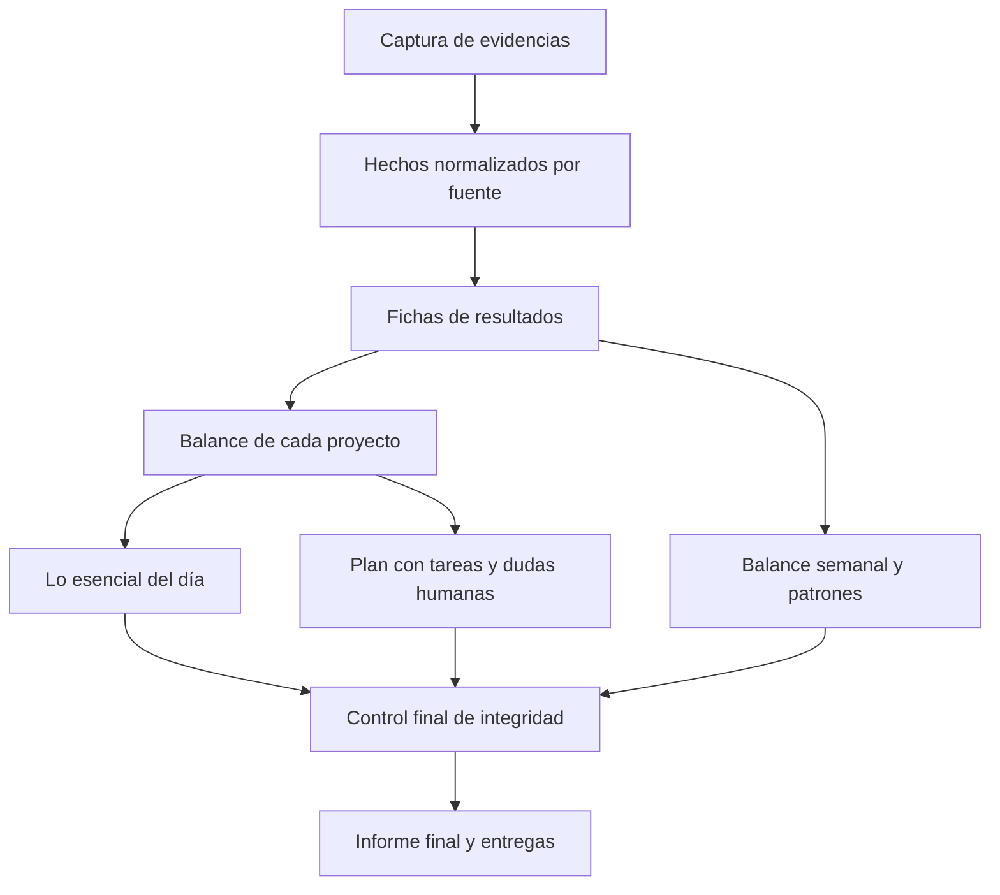

# Construcción jerárquica y reanudable del digest

Estado: propuesta de rediseño de fase 2. La exigencia de no sustituir secciones
no validadas por contenido mecánico está confirmada por la persona (D-047).
Este documento describe el cambio propuesto; no afirma que ya esté implementado.

## Qué falla en el flujo actual

La validación real intentaba enriquecer 43 resultados en una cadena y solo después
construir síntesis y plan. Un resultado puede reunir numerosos diffs y documentos;
que el paquete esté por debajo del máximo no significa que sea una unidad fácil
de interpretar. La síntesis vuelve a recibir evidencias originales, extracciones
y contexto de todos los proyectos. El plan vuelve a recibir evidencias.

Los reintentos HTTP, la reparación y el proveedor de respaldo pueden consumir
mucho tiempo en una sola pieza. No se reserva un presupuesto para las etapas
superiores. Los resultados válidos se mantienen en memoria hasta terminar la
construcción: interrumpir obliga a repetirlos. La auditoría registra
`output_invalid`, pero pierde la regla y el campo concretos que causaron el rechazo.
Por eso todavía no sabemos cuánto corresponde a errores del modelo, contratos
mal dimensionados o falsos rechazos del validador.

Las pruebas sintéticas y la revisión independiente demostraron propiedades de
seguridad y trazabilidad, pero no bastaban para demostrar utilidad ni tiempos
adecuados con los proyectos reales. Cambiar el proveedor no resuelve por sí solo
estos problemas de construcción.

## Qué se considera terminado

Un informe final contiene todas las secciones requeridas, todos los resultados
del intervalo y un manifiesto que acredita qué validaciones pasó cada pieza.
Una sección fallida queda pendiente, con motivo y siguiente acción; no se convierte
en un apartado mecánico ni se disfraza como «no hay conclusión nueva».

La ausencia de actividad verificable, la falta de evidencia científica y un fallo
técnico son situaciones distintas. La primera puede producir una salida válida
si la captura la acredita. Una afirmación «no verificable» necesita una limitación
concreta y trazable. Un timeout o un JSON rechazado no justifican ninguna de ellas.

Los borradores pueden mostrar el inventario completo y qué falta, pero no se
entregan como digest final ni cierran el intervalo. La entrega final se desbloquea
solo cuando el manifiesto está completo. Esto no obliga a cerrar ninguna revisión
humana: «validado por el sistema» nunca significa «comprendido por la persona».

## Etapas y contratos

Cada flecha exige una entrada validada; los nodos independientes pueden seguir
avanzando aunque otro esté pendiente. El ensamblado final no salta una dependencia.

| Etapa | Entrada | Salida | Control principal |
| --- | --- | --- | --- |
| Captura | Fuentes declaradas y permitidas | Evidencias con hash, fecha y cobertura | Rutas, lectura estable, secretos, event/observed |
| Hechos por fuente | Fragmento coherente de una nota, ejecución, tabla o documento | Observaciones pequeñas y tipadas con referencias | Esquema por fuente; cifras y unidades contra el dato original |
| Resultado | Hechos relacionados con una tarea o experimento | Qué se hizo, qué respalda, controles, límites y preguntas | Todas las afirmaciones conservan evidencia; distinguir observación e interpretación |
| Proyecto | Fichas válidas, objetivo científico y contexto previo validado | Qué cambia respecto al objetivo, qué falta y qué decisión permite | No confundir actividad técnica con conclusión científica |
| Diario y plan | Balances válidos; tareas y dependencias de Kanvas; dudas humanas | Lo esencial y acciones ejecutables | Límites de secciones, dependencias, origen y trazabilidad |
| Semanal | Evidencias y fichas de siete días, revisiones y planes aceptados | Patrones, cambios de hipótesis, pendientes y objetivos | No resumir diarios ni usar una síntesis previa como única prueba |
| Ensamblado | Nodos válidos e inventario del intervalo | Informe completo y manifiesto | Ningún resultado oculto; ninguna sección requerida pendiente |

### Hechos antes de narrativa

El código sigue calculando métricas, identificando tareas, leyendo fechas y
vinculando figuras. El modelo no vuelve a calcular ni transcribe innecesariamente
esos valores. Se usa LLM para interpretar fragmentos que lo requieran, con un
contrato pequeño adecuado al tipo de fuente, sin pedir todas las listas de una
extracción general para cualquier entrada.

Los paquetes se dividen por significado y procedencia: una comparación con su
control, una nota de cierre, una ejecución o una sección documental. Si una
comparación requiere varias fuentes se mantienen juntas o se incluyen dependencias
explícitas. No basta con cortar por caracteres o eliminar el final del contexto.

### De resultados a objetivos científicos

La ficha del resultado responde: pregunta, trabajo observado, evidencia, resultado,
control, limitaciones e interpretación. El balance de Benchmark y el de VCD se
construyen por separado frente a sus objetivos confirmados. Una implementación
correcta o un experimento terminado no se presentan automáticamente como una
conclusión científica nueva.

La síntesis global recibe balances breves y validados y un índice completo de
resultados, no otra copia de todos los diffs. El plan es otra etapa: usa esos
balances y el grafo determinista de tareas y dependencias, sin releer el repositorio.
El inventario de todas las tareas lo ensambla el código, no lo selecciona el modelo.

## Trazabilidad que sobrevive a la jerarquía

Cada nodo registra las versiones de sus entradas y los IDs de evidencia originales.
Una síntesis no obtiene permiso para afirmar algo solo porque una ficha lo diga:
se comprueban sus referencias hasta las fuentes. Cada conclusión identifica si es
observación o interpretación y las limitaciones que hereda. La validación mecánica
de referencias y cifras no demuestra por sí sola la corrección científica.

La restricción `external_allowed` también se hereda: abstraer o resumir un proyecto
privado no elimina su restricción. El ámbito de una pieza es la unión de todos sus
antecedentes, incluidos objetivos y texto humano. No se reabren archivos ni se
ejecuta contenido por petición del modelo.

## Guardado incremental y reanudación

Antes de iniciar un nodo se calcula una clave a partir de las evidencias y sus
hashes, las entradas ascendentes, el contrato, las versiones de prompt y validador
y la configuración relevante. Una salida válida se guarda inmediatamente con su
manifiesto; no espera a que termine el digest. Una salida rechazada no entra en la
caché válida. Un cambio invalida solo ese nodo y sus descendientes.

Al reiniciar se verifican y reutilizan las piezas válidas. Rehacer con otro modelo
crea otra variante, sin sobrescribir el texto humano ni la generación anterior.
El semanal reutiliza piezas con linaje verificable de toda la semana; no reutiliza
la prosa del diario como fuente científica.

Como primera implementación se proponen artefactos privados bajo `data_dir`,
con escrituras atómicas y formatos versionados, y referencias desde los parámetros
JSON del job. No se propone cambiar a escondidas los estados ni tablas SQLite
publicados. Si la persistencia requiere una migración, se presentará antes de
implementarla. Los estados lógicos de los nodos serán pendiente, en curso,
validado y fallido recuperable; deben distinguirse de los estados humanos.

Las ventanas de informe deben permanecer identificadas durante los reintentos.
Antes de implementar se concretará la reserva de intervalos pendientes y el
tratamiento de nuevos disparos, con pruebas de solapamiento y días consecutivos:
no se cerrarán intervalos sin informe final ni se perderán o duplicarán evidencias.

## Diagnóstico y reparación localizada

Para cada rechazo se guardan etapa, contrato/prompt, código de regla, campo,
referencias implicadas, proveedor/modelo, duración y decisión siguiente. Los
valores de entrada sensibles nunca forman parte de excepciones o logs. Si se
conserva una salida para depurar, será saneada, acotada y privada.

La reparación actúa sobre el fragmento y los campos que fallaron, con sus evidencias.
No se regenera un proyecto entero ni se reintentan de igual modo un timeout, una
referencia inexistente y una cifra inventada. Si el paquete es demasiado complejo,
se subdivide manteniendo sus dependencias; si faltan evidencias, se registra esa
carencia. No se relaja un validador para que pase una respuesta.

Los contratos se ensayan contra ejemplos reales saneados: deben rechazar errores,
pero también aceptar paráfrasis, signos, unidades y cantidades correctas. La tasa
de rechazo genérica no permite decidir qué modelo es mejor.

## Tiempo y modelos

El presupuesto de tiempo se reparte por etapas y nodos; una pieza no puede agotar
la posibilidad de construir el balance y el plan. Al agotarse un intento se guarda
el progreso y se deja pendiente la continuación. El límite deja de ser un disparador
de publicación mecánica. Los reintentos y la cola necesitan límites para no crear
un bucle de gasto indefinido.

Se mantiene el enrutado configurable por tarea. Primero se calibran contratos y
paquetes; después se comparan proveedores sobre esas mismas entradas. Se consideran
latencia y calidad de salidas válidas, no solo rapidez o HTTP 200. La concurrencia,
si se añade, sigue controlada dentro del único worker y por límites verificados.

## Orden de implementación y aceptación

1. Diagnóstico específico y bloqueo de publicación incompleta. T16 pasa a exigir
   que la caída de ambos proveedores conserve un trabajo pendiente sin entrega
   ni cierre. El comportamiento anterior deja de cumplir la especificación.
2. Normalización y paquetes por fuente: probar cifras/unidades correctas e
   incorrectas, contextos grandes y fragmentos que necesitan controles conjuntos.
3. Nodos persistidos: interrumpir tras varias piezas, reanudar sin repetir llamadas
   válidas y cambiar una evidencia para invalidar solo la rama afectada.
4. Fichas, balances y síntesis jerárquica de diario/semanal. Una pieza fallida no
   impide guardar las independientes, pero bloquea la publicación final.
5. Nueva revisión independiente y validación real con los dos proyectos: cinco
   afirmaciones contrastadas, plan ejecutable y balance científico útil. Verificar
   además que todos los resultados siguen visibles y no se transmiten secretos
   ni contenido privado a un proveedor externo.

La fase 2 permanece abierta. La aprobación técnica anterior corresponde al flujo
anterior y no sustituye la revisión de estos cambios.
